# Quick Start — TGui

**TGui** is a graphical interface for [Tarantool](https://www.tarantool.io/) that lets you create and manage data spaces (tables), link them, define computed columns or triggers, and compose declarative custom views (YAML).

This guide walks you step by step from zero to a fully functional **school library management** application: book catalog, physical copies, borrowers, and loans.

---

## Prerequisites

- [Docker](https://www.docker.com/) (or Tarantool 3.x installed locally)
- `make`, `git` and `coffee` (CoffeeScript) — only needed to modify sources; the MoonScript compiler is a git submodule (run `git submodule update --init`)
- [Nix](https://nixos.org/) with [direnv](https://direnv.net/) (recommended to modify sources): run `direnv allow` once at the repository root; the dev shell then loads automatically when entering the directory (without direnv, use `nix develop`)

---

## Launch

```bash
git clone <repo>
cd tgui
docker compose up
```

The interface is available at **http://localhost:8080**.

---

## Login

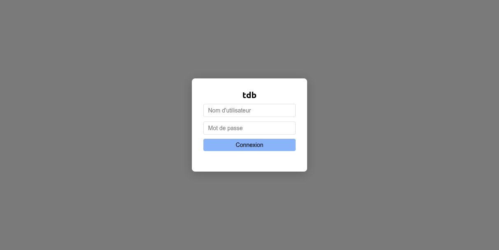

---

## Overview of the interface

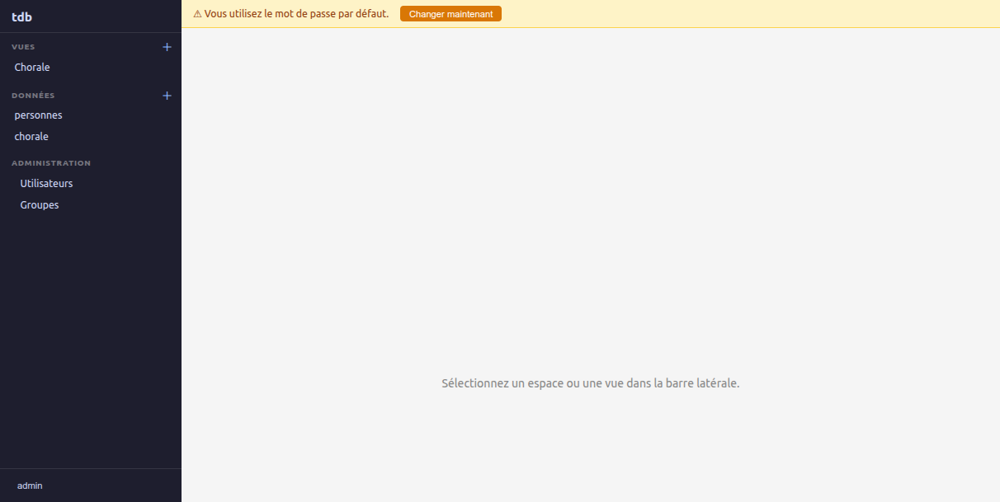

The interface is divided into two areas:

| Area | Role |
|------|------|
| **Sidebar** (left) | Navigation between Views, Data and Administration |
| **Content** (right) | Data grid, view editor or administration panel |

---

## Create the spaces (tables)

The library is built on 12 tables. Create them in the following order to make relations easier to define: first the reference tables, then the main tables, then the join tables, and finally the transaction table.

### 1 — Reference tables

These tables have no dependency on other tables.

1. In the **Data** section of the sidebar, click **+**.
2. Enter the space name and confirm.
3. Repeat for each table.

| Space | Role |
|--------|------|
| `genres` | Literary genres (novel, comic, non-fiction, …) |
| `auteurs` | Book authors |
| `classes` | School classes |
| `motscles` | Thematic keywords |
| `etiquettes` | Classification labels (prize, favorites, …) |

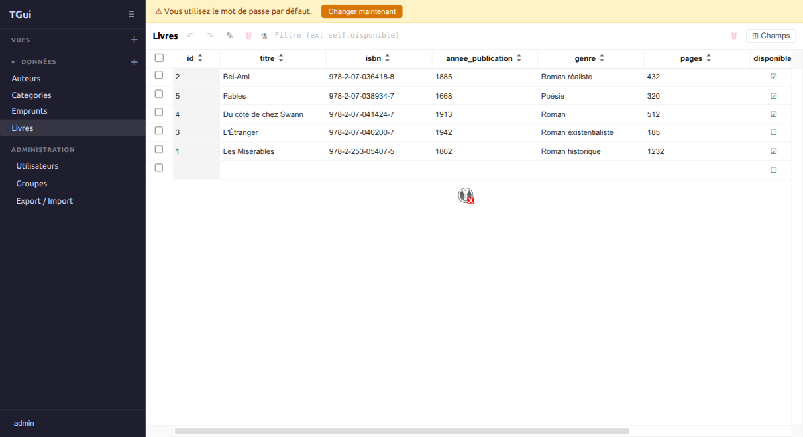

### 2 — Main tables

| Space | Role |
|--------|------|
| `livres` | Catalog of titles (bibliographic references) |
| `personnes` | Students and staff who can borrow |
| `exemplaires` | Physical copies of each title |
| `coordonnees` | Contact details for people |

### 3 — Many-to-many join tables

| Space | Role |
|--------|------|
| `livres_motscles` | Book ↔ keyword association |
| `livres_etiquettes` | Book ↔ label association |

### 4 — Transaction table

| Space | Role |
|--------|------|
| `emprunts` | Records of loans (copy + borrower + dates) |

---

## Add and manage fields

Click **[#] Fields** in the toolbar to open the side panel.

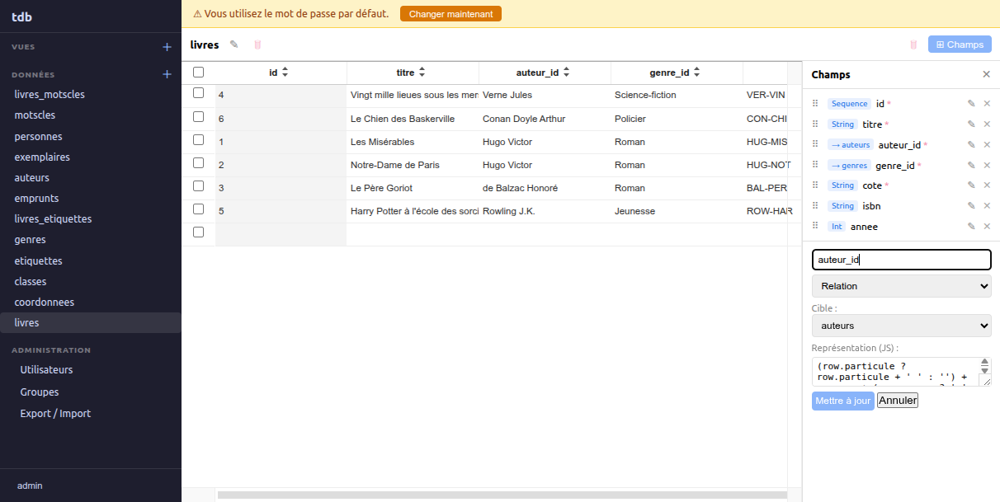

### Create a simple field

1. Enter the **name** of the field.
2. Choose the **type**: `String`, `Int`, `Float`, `Boolean`, `UUID`, `Sequence`, `Any`, `Map`, `Array`, or `Relation`.
3. Check **Required** if the value cannot be null.
4. Click **Add**.

### Example: fields of the `auteurs` space

| Field | Type | Required |
|-------|------|--------|
| `id` | Sequence | — |
| `particule` | String | no |
| `nom` | String | **yes** |
| `prenom` | String | no |

### Example: fields of the `livres` space

| Field | Type | Required | Note |
|-------|------|--------|----------|
| `id` | Sequence | — | |
| `titre` | String | **yes** | |
| `auteur_id` | Relation | no | → `auteurs` |
| `genre_id` | Relation | no | → `genres` |
| `cote` | String | no | Shelf mark |
| `isbn` | String | no | Nullable |
| `annee` | Int | no | Publication year, nullable |

### Computed column (λ)

Select **Computed column** and enter a MoonScript or Lua expression.
The formula is the body of a function `(self, space) -> <expression>`; in MoonScript `@field` accesses `self.field`. The value is recomputed on each read and is not stored.

**Example: `nom_complet` in `auteurs`** — combine first name, particle and last name while handling nulls:

```moonscript
parts = {}
table.insert(parts, @prenom) if @prenom and @prenom != ""
table.insert(parts, @particule) if @particule and @particule != ""
table.insert(parts, @nom) if @nom and @nom != ""
table.concat(parts, " ")
```

The `space` parameter gives access to records of another space (full scan):

```moonscript
-- Count available copies for this book
n = 0
for e in *space("exemplaires")
  n += 1 if e.livre_id == @id and e.disponible
n
```

### Trigger formula ((trigger))

Select **Trigger formula** and optionally list the trigger fields.
The formula is executed and the result **stored** on each creation or modification of the listed fields.

**Example: `cote_auto` in `livres`** — generate an automatic shelf mark from the first three letters of the title and the year (triggered on `titre` and `annee`):

```moonscript
-- triggerFields: ["titre", "annee"]
prefix = (@titre or "")\upper!\sub(1, 3)\gsub("[^%A]", "")
annee  = if @annee then tostring(@annee) else "????"
"#{prefix}-#{annee}"
```

### Edit an existing field

Click the **(pencil)** icon next to a field to edit its name, type, formula or trigger.

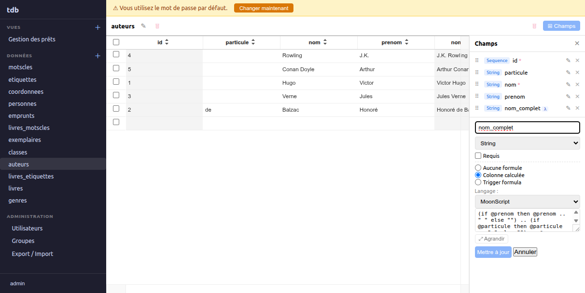

---

## Entering and editing data

- Click a cell to edit it directly in the grid.
- Press **Enter** or Tab to move to the next cell.
- To **add a row**, click in the empty area below the last row.
- To **delete rows**, select them (checkboxes) then click the [del] “Delete selected rows” button.

Start by entering data in the reference tables (`genres`, `auteurs`, `classes`) before filling `livres`, `personnes` and `exemplaires`.

---

## Relations between spaces

In the **Fields** panel choose the **Relation** type for `_id` fields:

1. Select the **target** space from the dropdown.
2. The field will store the identifier of the linked record.

Here are the relations to create for the library:

| Source field (space) | Target space |
|-----------------------|-------------|
| `livres.auteur_id` | `auteurs` |
| `livres.genre_id` | `genres` |
| `exemplaires.livre_id` | `livres` |
| `emprunts.exemplaire_id` | `exemplaires` |
| `emprunts.personne_id` | `personnes` |
| `personnes.classe_id` | `classes` |
| `coordonnees.personne_id` | `personnes` |
| `livres_motscles.livre_id` | `livres` |
| `livres_motscles.motcle_id` | `motscles` |
| `livres_etiquettes.livre_id` | `livres` |
| `livres_etiquettes.etiquette_id` | `etiquettes` |

Relations can then be used to build custom views with automatic filtering (inter-widget dependencies).

### Representation formula (reprFormula)

By default, a Relation column displays the raw identifier of the linked record. You can define a **representation formula** in MoonScript to show a human-friendly label instead.

- The syntax `@field` accesses fields of the linked record.
- FK fields are resolved automatically: `@genre_id.libelle` follows the `genre_id` relation in the linked space and returns its `libelle`.
- Multi-level chaining is supported: `@livre_id.genre_id.libelle` (copy → book → genre).
- If no formula is defined, the column uses the `_repr` field of the target space (if present), otherwise the raw id.

**Examples:**

| Formula | Effect |
|---------|-------|
| `@nom` | Shows the `nom` field of the linked record |
| `@nom .. ' ' .. @prenom` | Concatenates last name and first name |
| `@genre_id.libelle` | Follows the FK `genre_id` and displays the genre label |
| `@livre_id.genre_id.libelle` | Chains two FKs (copy → book → genre) |

**Concrete example — loans:**

In the `emprunts` space, the `exemplaire_id` column can display the title of the corresponding book by chaining FKs:

```
reprFormula : @livre_id.titre
```

(To show the book title for this copy.)

To set the formula, click the **(pencil)** next to the Relation field in the Fields panel and enter the representation formula in the **Representation formula** field.

---

## Custom views (YAML)

Views let you compose multi-space dashboards.

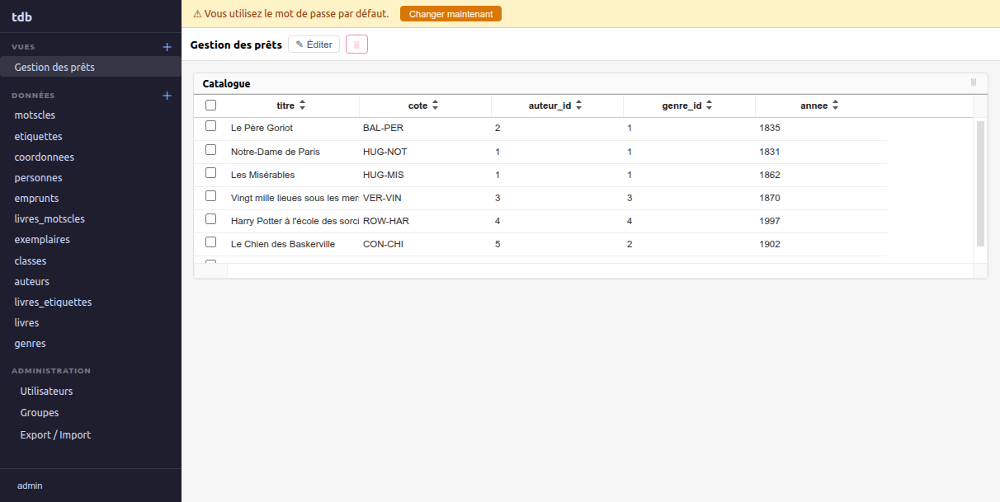

### Create a view

1. In the **Views** section click **+**.
2. Give the view a name (e.g. `Loans management`).
3. The YAML editor opens automatically.

### YAML editor with ERD schema

Clicking **Edit** opens a fullscreen modal with two panels:

- **Left**: CodeMirror editor (YAML syntax highlighting, monokai theme).
- **Right**: interactive ERD diagram showing all spaces and their relations.

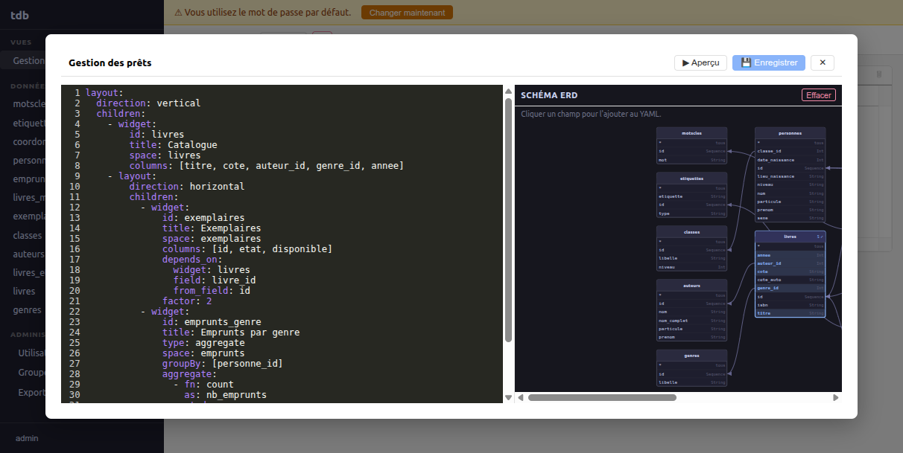

**Use the ERD diagram to build the YAML:**

Each box represents a space. For each field (row):

- Click **`*`** (first row, italic) to add the space **without column restrictions**. The box lights up with the `* ✓` badge.

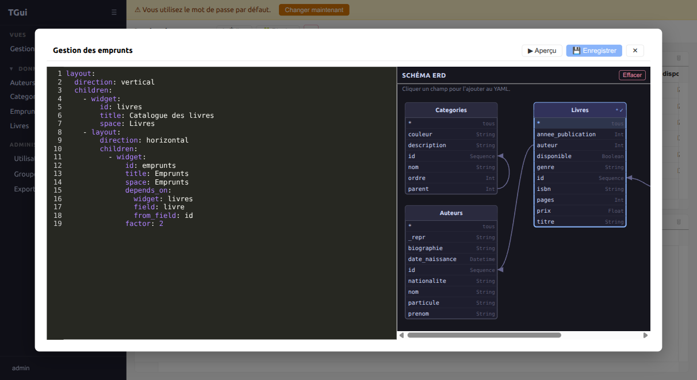

- Click a **named field** to add it to the widget's `columns` list. If the space is not yet in the YAML it is created. If that space has a foreign key to an already-present space in the YAML, a `depends_on` is generated automatically.

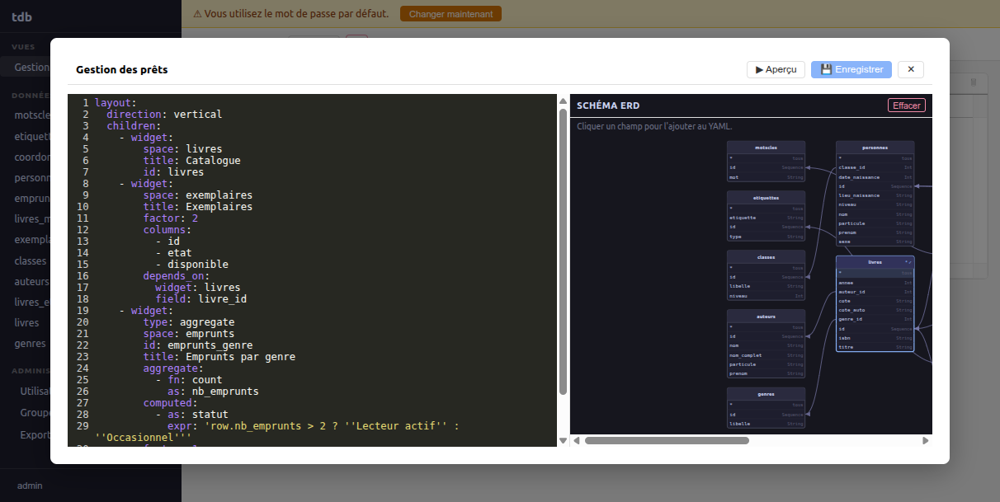

- Clicking a selected field again removes it. Removing all fields deletes the widget.
- The **Clear** button resets the selection.
- **Arrows** indicate foreign keys; **self-relations** (e.g. `parent_id → id`) are drawn as a loop on the right side of the box.

**Bidirectional sync:** the ERD initializes from the existing YAML when opening the modal — spaces and fields already defined are highlighted. Editing the YAML manually in CodeMirror updates the diagram in real time. Fields not managed by the builder (like `title`, `aggregate`, `computed`) are **preserved** when editing via the diagram.

**Modal buttons:**

| Button | Action |
|--------|--------|
| **↓ Save** | Save the YAML |
| **▶ Preview** | Show the rendered view |
| **×** | Close the modal without saving |

### View “Loans management”

The main library view shows books, their copies and current loans, with a summary by genre.

```yaml
layout:
  direction: vertical
  children:
    - widget:
        id: livres
        title: Catalogue des livres
        space: livres
        columns: [titre, cote_auto, auteur_id, genre_id, isbn, annee]
    - layout:
        direction: horizontal
        children:
          - widget:
              id: exemplaires
              title: Exemplaires
              space: exemplaires
              depends_on:
                widget: livres
                field: livre_id
                from_field: id
              columns: [etat, disponible]
              factor: 2
          - widget:
              id: emprunts_en_cours
              title: Emprunts en cours
              space: emprunts
              depends_on:
                widget: exemplaires
                field: exemplaire_id
                from_field: id
              columns: [personne_id, date_emprunt, date_retour]
              factor: 3
```

### Aggregate widget — Loans by genre

An `aggregate` widget shows a read-only summary table — the equivalent of an SQL `GROUP BY`, computed in Lua on the server side.

```yaml
- widget:
    type: aggregate
    title: Emprunts par genre
    space: emprunts
    groupBy: [genre_id]
    aggregate:
      - fn: count
        as: nb_emprunts
    computed:
      - as: label
        expr: "row.genre_id + ' (' + row.nb_emprunts + ')'"
      - as: statut
        expr: "row.nb_emprunts > 10 ? 'Actif' : 'Peu emprunté'"
```

Available functions are `sum`, `count`, `avg`, `min`, `max`. The `as` alias is optional (default name: `fn_field`, e.g. `count`).

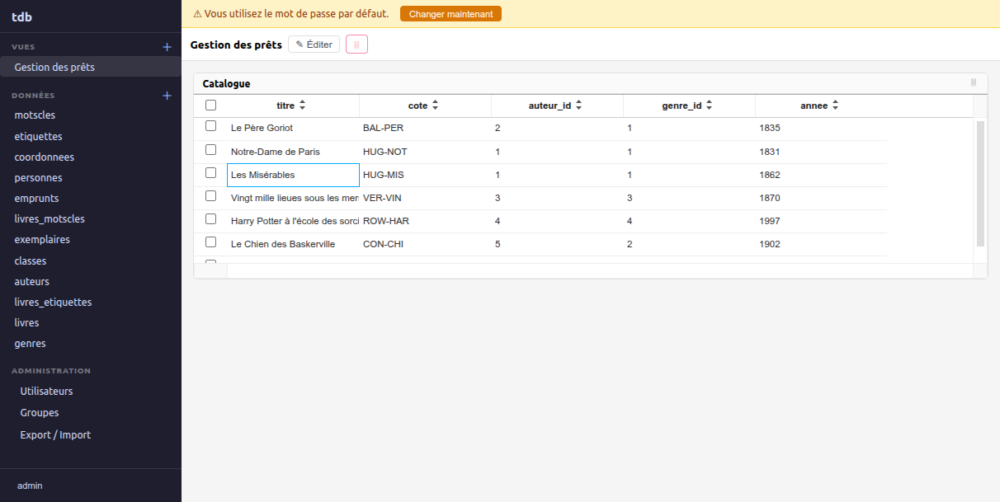

### Custom widget plugins

A custom widget is a **reusable definition** (script code + template, and optionally a
`manifest`) instantiated in a page by name. Fixing the definition updates every page that
uses it.

An existing definition is listed under **Custom widgets** in a page's **＋ Widget** window.
Pick it as the widget type:

- with a `manifest`, section **3. Parameters** becomes a field selector per declared column
  (filtered by type, "—" for an optional column) and an input per option, prefilled with
  its default;
- without a `manifest`, the usual key/value pairs, with no column selection.

The same window links to the plugin editor (**New custom widget…**, admins only).

#### Definition scope

A definition lives in **exactly one scope**:

- the **library** (global): usable from every page of the instance;
- one **installed app**: the definition belongs to that app's package.

A page instance resolves the definition of the **page's app** (the app that delivered the
page) first, then the library one. A name is unique **per scope** only: two apps, or an app
and the library, may define the same name without clashing. The **＋ Widget** window and the
editor show the scope (`library` or `app <id>`), and the editor lets you choose it when
creating a definition (it can be changed later).

Deleting a library definition still used by a page is **refused**: the message lists the
pages. A definition owned by an app goes away with it.

#### Create a plugin

1. Open a custom view.
2. Click **🧩 Plugins** in the view toolbar.
3. Click **+ New**.
4. Fill `name` (the widget `type` in YAML), the description, the **scope** (library or
   app), the script language and code, the template language and code, and optionally the
   **YAML manifest** (third editor).
5. Click **💾 Save**, then close (`✕`) to reload the pages using the plugin.

#### Plugin script contract

The script exports a function:

```coffeescript
module.exports = ({ gql, emitSelection, onInputSelection, onRecords, onRecord, setCursor, render, params }) ->
  render "<div>Ready</div>"
```

- `render(html)`: updates the widget HTML inside the sandboxed iframe.
- `params`: widget params from YAML (`widget.params`).
- `emitSelection({ rows, byField })`: emits a selection for dependent widgets
  (`depends_on`).
- `onInputSelection(cb)`: receives the upstream widget selection.
- `gql(query, variables)`: GraphQL request relayed by the parent, **filtered by `access`**
  (see below).
- `onRecords(cb)`, `onRecord(cb)`, `setCursor(id)`, and for `access: full`
  `updateRecord(id, values)`, `insertRecord(values)`, `deleteRecord(id)`: the data API
  described below.

#### Manifest (optional)

```yaml
access: read            # none | read | full (default: read once a manifest exists)
columns:                # columns expected from the source
  - {name: titre, type: String}
  - {name: debut, type: Date}
  - {name: fin, type: Date, optional: true}
options:                # typed instance options
  - {name: couleur, type: color, default: '#36c'}
```

- **`access`** — what the widget may do, enforced by the parent before any relay:

  | `access` | Allowed |
  |---|---|
  | `none` | `params`, `render`, selection; no data, no `gql` |
  | `read` | + reading the source (`onRecords`…), `gql` limited to *queries* |
  | `full` | + `updateRecord` / `insertRecord` / `deleteRecord` on the source, data mutations through `gql` |

  Without a manifest the effective access is `full` (existing plugins keep working). An
  operation that cannot be parsed is refused. Whatever the value, schema, user, group and
  app mutations are refused by the server, and resolvers still apply the user's own
  permissions.

- **`columns`** — expected source column names and types. The instance maps them in the
  page YAML (`columns: {<declared name>: <field>}`). A required column left unmapped shows
  a message in the widget: nothing is loaded.

- **`options`** — typed options (`color`, `number`, `boolean`, anything else as text),
  stored in `params`. The "＋ Widget" window prefills the default value.

#### Data API inside the iframe

- `onRecords(cb)`: rows of the widget source (space or Data View), **renamed according to
  the mapping** (`{id, titre, debut, …}`); called again after every write made by the
  widget.
- `onRecord(cb)`: current row received from the upstream widget (`depends_on`), renamed the
  same way.
- `setCursor(id)`: emits that row's selection for downstream widgets.
- `updateRecord(id, values)`, `insertRecord(values)`, `deleteRecord(id)` (`full` access
  only): keys of `values` are the **declared names** (translated to field names by the
  parent); each call returns a promise.

#### Use a plugin in YAML

`type` is the plugin name. With a manifest, declare the column mapping next to `params`:

```yaml
- widget:
    id: calendar
    type: calendar
    title: Calendar
    space: events
    columns: {titre: nom, debut: date_debut, fin: date_fin}
    params: {couleur: '#c33'}
```

`depends_on` works like for space widgets:

```yaml
- widget:
    id: detail
    type: card
    depends_on:
      widget: calendar
      field: event_id
      from_field: id
```

#### Troubleshooting

- A compilation error (script or template) names the plugin, the source (`script` or
  `template`), the language, and the line/column when available.
- A runtime error inside the iframe shows `Plugin <name> — exécution JavaScript invalide …`
  with the details.
- `runtime CoffeeScript indisponible` / `runtime Pug indisponible` means a missing or
  broken vendor bundle. That bundle (`/vendor/plugin-runtime.bundle.js`) is loaded **only
  when a widget that needs it is displayed**: a `javascript` + `html` widget loads
  nothing. A failed load is shown inside the widget:
  `Erreur plugin : Échec du chargement de /vendor/plugin-runtime.bundle.js …`.
- A denied request shows the parent's explicit message inside the iframe (`manifest
  access: read`, `access: none`, "lectures seules", …).

---

## User and rights management (admin)

The **Administration** section is visible only to members of the `admin` group.

### Users

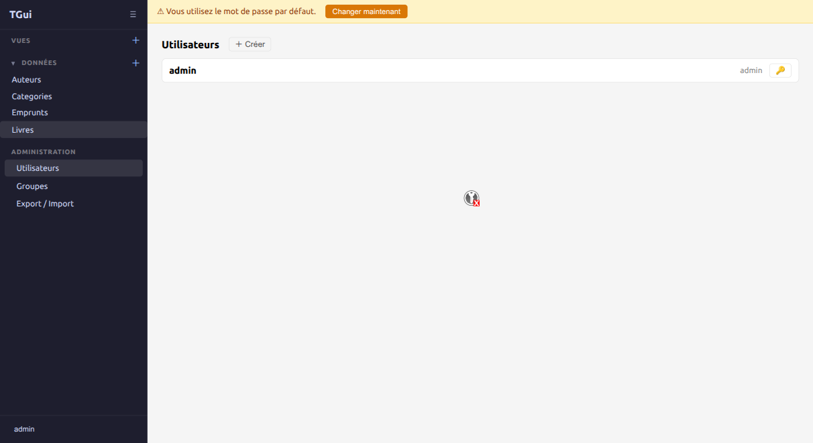

- **+ Create**: opens a form (username, optional email, password).
- **[key]** on each row: allows the admin to force a password change for a user without knowing their current password.

### Groups

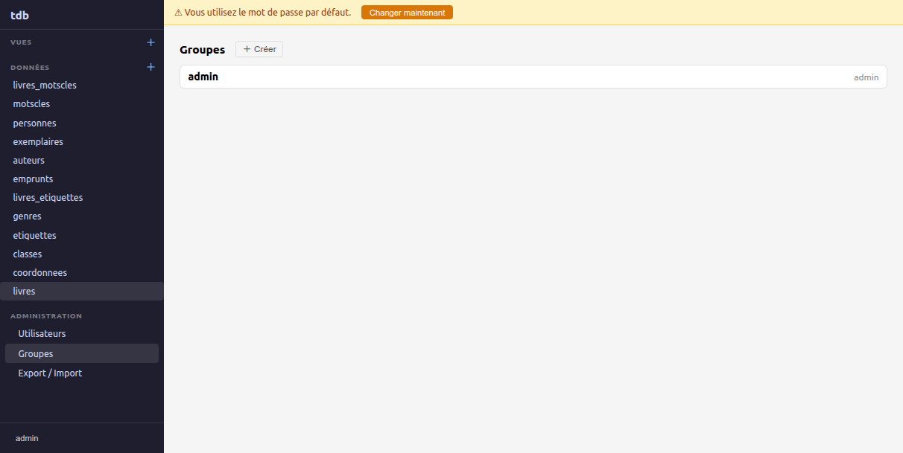

- **+ Create**: creates a new group.
- **[del]**: deletes the group (except the protected `admin` group).

> Rights (`grant` / `revoke`) are currently manageable via the GraphQL API.

### Export and import snapshots

The **Export / Import** section allows saving and restoring a TGui application.

**Export:**

- **Structure only**: downloads a `.tdb.yaml` file containing the full schema (spaces, fields, relations, views, groups, permissions) without data.
- **Structure + data**: includes all rows of each space.

**Import:**

1. Click **Choose file** and select a `.tdb.yaml` file.
2. A **diff** is shown (green = create, red = delete, orange = modify).
3. Choose mode:
   - **Merge**: create missing elements, leave existing ones untouched.
   - **Replace**: delete everything and recreate from the snapshot (warning: data loss).
4. Click **Confirm import**.

### Applications (packaging and updates)

The **Applications** panel lets an administrator distribute a whole TGui application as a package and receive later versions without rebuilding it from scratch.

#### Package format

A package is a `.tdbapp.yaml` file. Its header is `app: {id, name, version, description}`: `id` is a stable, globally unique identifier (for example `org.exemple.biblio`), `name` is a display name, and `version` follows `x.y.z` (semver). The body contains spaces (with their fields and relations), data views, pages, YAML widget plugins, groups with their default permissions, and seed rows for the spaces you list. Every element is identified by a stable key (its name inside its scope), never by a local UUID; a rename is declared with `renamed_from`.

#### Export an application

1. Open **Administration > Applications**, then the **Export an application** box.
2. Fill in the **Identifier** (for example `org.exemple.biblio`), the **Name**, the **Version (x.y.z)** and an optional **Description**.
3. In **Seed lines (one per line, space:keyField)**, add one line per space whose rows must travel with the package, in the form `space:keyField` (for example `livres:isbn`). The space and the key field must already exist, and the key value must be unique on every row: a missing value on a required key field, or two rows sharing the same key value, refuses the export. Rows that leave an optional key field empty are considered local and left out.
4. Click **Export package**. The browser downloads `<id>-<version>.tdbapp.yaml`.

#### Install or update

1. In **Install or update**, click **Choose file** and select a `.tdbapp.yaml` package.
2. A **Change preview** is shown before anything is written:
   - **Created**: elements that do not exist locally.
   - **Updated**: elements you have not modified but the author changed.
   - **Kept (locally modified)**: elements you modified and the author kept as they were.
   - **Renamed**: elements renamed by the author, matched through `renamed_from`; their data is kept.
   - **Obsolete**: elements the new version no longer contains; they are not deleted.
   - **Conflicts**: elements modified both locally and by the author.
3. Code delivered by a third party (plugins, pages, data views, formula fields) is marked **Third-party code** with the warning **Code delivered by a third party: review it before applying**; open **View delivered content** to inspect it.
4. For each **Conflict**, choose **Keep mine** (the default) or **Take delivered version**.
5. To install a version lower than the one already installed, tick **Allow an older version**; otherwise the update is refused.
6. Click **Apply** and confirm.

#### What an update guarantees

- No record is ever deleted.
- Elements created locally on the instance (absent from the application tracking) are never touched.
- Elements the author removed become **obsolete** but stay in place.
- Groups are created only when missing; local members and permissions are preserved.
- Seed rows: new ones are added, rows not modified locally are updated, locally modified rows are kept, none are deleted.
- The whole update is atomic: on error, the previous state is restored.

#### Purge obsolete elements

1. In **Installed applications**, click **Obsolete items…** (enabled as soon as an application has obsolete elements).
2. Select the elements to purge, then click **Preview losses**. A red warning (**Permanent deletion — the data of these items will be lost.**) lists, per element, the number of records, fields, relations and views that will be lost.
3. Type exactly the requested value: the item name (the part after the last `:`) when a single element is selected, or the application identifier when several are selected. Then click **Purge permanently**. The purge is definitive.

Only obsolete elements tracked for an application can be purged; an active or purely local element can never be purged.

> **Known limitation:** when an element is renamed, formulas that reference its old name as plain text are not rewritten.

---

## User profile

Click your **username** (bottom left) to open the menu:

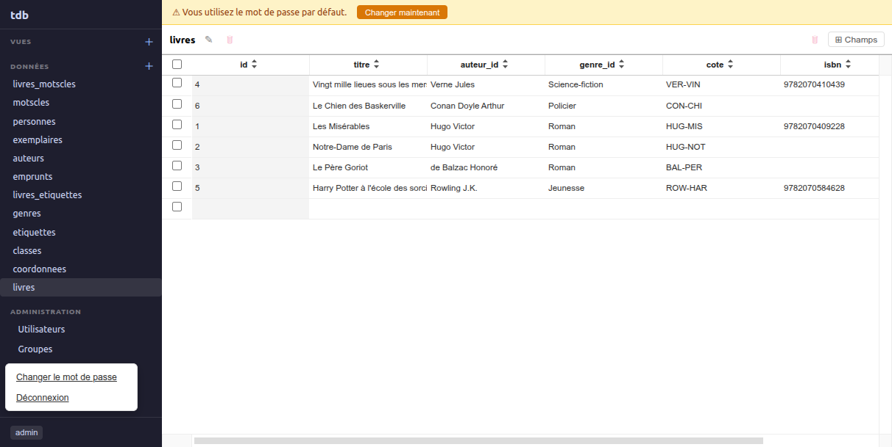

- **Change password**: enter the old and the new password.
- **Logout**: invalidates the session on the server and returns to the login screen.
- **FR / EN**: changes the interface language (preference is stored locally in the browser).

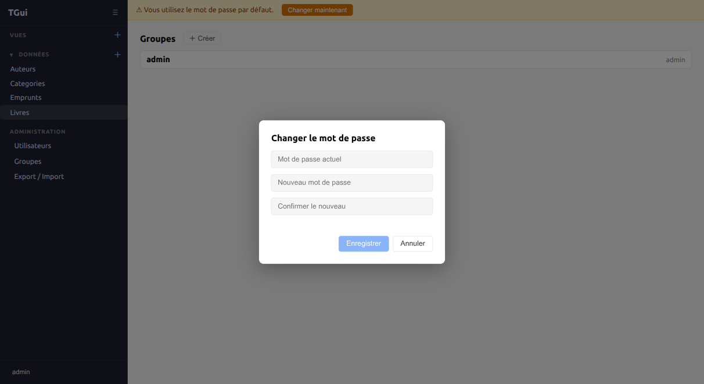

---

## Rename or delete a space

In the space toolbar:

- **(pencil)** (pencil icon): rename the space.
- **[del]** (trash icon next to the title): delete the space and all its data.

---

## Keyboard shortcuts

| Key | Action |
|--------|--------|
| **Enter** | Confirm cell edit |
| **Escape** | Cancel current edit |
| **Tab** | Move to the next cell |
| **Enter** on the login screen | Log in |

