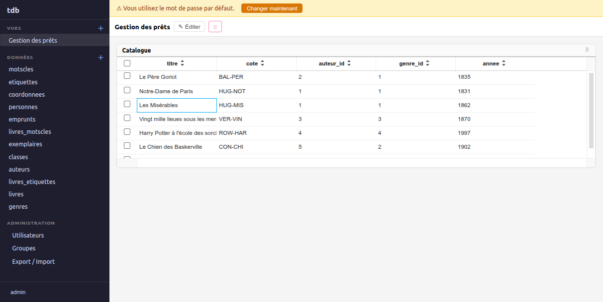

# Feature Reference — TGui

TGui exposes all its features via a **GraphQL API** at `http://localhost:8080/graphql`. The web interface is a client of this same API; anything possible in the UI can also be done directly via GraphQL queries.

---

## Table of Contents

1. [Spaces (tables)](#1-spaces-tables)
2. [Fields](#2-fields)
3. [Relations](#3-relations)
4. [Data (records)](#4-data-records)
5. [Classic Views](#5-classic-views)
6. [Custom Views (YAML)](#6-custom-views-yaml)
7. [Data Views (Saved Queries)](#7-data-views-saved-queries)
8. [Authentication](#8-authentication)
9. [Users and Groups](#9-users-and-groups)
10. [Permissions](#10-permissions)
11. [Export and Import Snapshots](#11-export-and-import-snapshots)
12. [Full GraphQL API](#12-full-graphql-api)
13. [Applications (packaging and updates)](#13-applications-packaging-and-updates)
14. [Sorting and filtering a grid](#14-sorting-and-filtering-a-grid)

---

## 1. Spaces (tables)

A **space** is a user-defined data table. It contains **fields** (columns) and **records** (rows).

### UI Operations

| Action    | How |
|-----------|-----|
| Create    | Click **+** in the Data section |
| Rename    | **(pencil)** button in the space toolbar |
| Delete    | **[del]** (trash can next to the title) |
| Navigate  | Click the name in the sidebar |

### GraphQL API

```graphql
# List all spaces
query {
  spaces { id name description fields { id name fieldType } }
}

# Space details, including nested records
query {
  space(id: "...") {
    id name fields { id name fieldType formula }
    records(limit: 10, offset: 0, filter: { field: "status", op: EQ, value: "active" }) {
      items { id data }
      total
    }
  }
}

# Create
mutation {
  createSpace(input: { name: "livres", description: "Book catalog" }) { id }
}

# Rename
mutation {
  updateSpace(id: "...", input: { name: "new_name" }) { id name }
}

# Delete
mutation { deleteSpace(id: "...") }
```

---

## Nested Queries (Nesting)

In addition to fetching simple relations (FK) directly within records, it is possible to **query collections of related records (back-references) with pagination and filtering directly within a parent query**.

### Back-references with pagination and filtering

Dynamically generated back-reference fields (based on inverse relations) support `limit`, `offset`, and `filter` arguments:

```graphql
# Fetch users and their tasks, filtering tasks by title
query {
  users {
    id
    username
    groups {
      id
      name
    }
  }
}
```

### Direct access to space records via `Space.records`

The `Space` type exposes a `records` field that allows direct retrieval of records from a given space, with pagination and filtering, without going through the root `Query.records`:

```graphql
# Fetch space details and its first 10 records
query {
  space(id: "my_space_id") {
    name
    records(limit: 10, offset: 0) {
      items { id data }
      total
    }
  }
}
```

---

## 2. Fields

A **field** is a column of a space. Each field has a type, a name, and may have a formula.

### Available Types

| Type      | Description |
|-----------|-------------|
| `String`  | String |
| `Int`     | Integer |
| `Float`   | Decimal number |
| `Boolean` | Boolean (`true` / `false`) |
| `UUID`    | Automatically generated UUID |
| `Sequence`| Auto-increment integer (natural primary key) |
| `Any`     | Free type (JSON) |
| `Map`     | JSON object |
| `Array`   | JSON array |
| `Datetime`| Date and time |
| `Relation`| Reference to a record in another space (display customizable via `reprFormula`) |

### Computed Field (calculated column)

A computed field evaluates a **MoonScript expression** on each read. The value is **not stored**.

The formula is the body of a function `(self, space) -> <formula>`. In MoonScript, `@field` is a shortcut for `self.field`:

**Example: `nom_complet` in `auteurs`** — combines first name, particle, and last name, handling null values:

```moonscript
parts = {}
table.insert(parts, @prenom) if @prenom and @prenom != ""
table.insert(parts, @particule) if @particule and @particule != ""
table.insert(parts, @nom) if @nom and @nom != ""
table.concat(parts, " ")
```

### Trigger formula

A trigger formula is evaluated and its result **stored** on each creation or modification of the record (or only when listed fields in `triggerFields` change).

**Example: `cote_auto` in `livres`** — generates a bibliographic code from the first three letters of the title and the year (triggered on `titre` and `annee`):

```moonscript
-- triggerFields: ["titre", "annee"]
prefix = (@titre or "")\upper!\sub(1, 3)\gsub("[^%A]", "")
annee  = if @annee then tostring(@annee) else "????"
"#{prefix}-#{annee}"
```

### Formula languages

| Value        | Description |
|--------------|-------------|
| `moonscript` | MoonScript (compiled → Lua on the fly) |
| `lua`        | Native Lua |

### Helper `space` — access to other spaces

Formulas and triggers receive a second parameter `space` that allows access to all records of another space (full scan):

```moonscript
-- Count available copies for this book
n = 0
for e in *space("exemplaires")
  n += 1 if e.livre_id == @id and e.disponible
n
-- Get the label of a book's genre
next(g for g in *space("genres") when g._id == @genre_id)?.libelle
```

`space("name")` returns a Lua list of all records in the space `name`, each record being an object with `_id` (identifier) plus all data fields. Returns `{}` if the space does not exist.

> **Note:** Full scan is suitable for small spaces (a few thousand records). For large volumes, prefer relations and aggregate widgets.

### Reordering

Fields can be reordered by drag-and-drop (::) in the Fields panel.

### Custom Relation Display (`reprFormula`)

For `Relation` type fields, `reprFormula` controls how the relationship is displayed
in the interface (grids, forms, etc.). The formula receives the linked record
as parameter (`self`) and must return a string.

**Example:** For an `auteur_id` field pointing to the `auteurs` space:

```moonscript
# Display "First Last" instead of UUID
"#{@nom} #{@prenom}"
```

```lua
-- Equivalent Lua version
return self.nom .. " " .. self.prenom
```

### Field Type Conversion

The `changeFieldType` mutation allows converting a field from one type to another,
with an optional conversion formula to transform existing data.

**Example:** Convert a `String` field to `Int`:

```graphql
mutation {
  changeFieldType(fieldId: "...", input: {
    fieldType: Int,
    conversionFormula: "tonumber(self.amount)",
    language: "lua"
  }) { id name fieldType }
}
```

If `conversionFormula` is omitted, values are automatically converted when possible,
or set to `null` otherwise.

### GraphQL API

```graphql
# Add a simple field
mutation {
  addField(spaceId: "...", input: {
    name: "age", fieldType: Int, notNull: false
  }) { id name }
}

# Add a computed column
mutation {
  addField(spaceId: "...", input: {
    name: "nom_complet", fieldType: String,
    formula: "parts = {}\ntable.insert(parts, @prenom) if @prenom and @prenom != \"\"\ntable.insert(parts, @particule) if @particule and @particule != \"\"\ntable.insert(parts, @nom) if @nom and @nom != \"\"\ntable.concat(parts, \" \" )",
    language: "moonscript"
  }) { id }
}

# Add a trigger formula (triggered on change of "titre" or "annee")
mutation {
  addField(spaceId: "...", input: {
    name: "cote_auto", fieldType: String,
    formula: "prefix = (@titre or \"\")\\upper!\\sub(1, 3)\\gsub(\"[^%A]\", \"\")\nannee  = if @annee then tostring(@annee) else \"????\"\n\"#{prefix}-#{annee}\"",
    triggerFields: ["titre", "annee"],
    language: "moonscript"
  }) { id }
}

# Update an existing field
mutation {
  updateField(fieldId: "...", input: {
    formula: "self.prenom .. \" \" .. self.nom",
    language: "lua"
  }) { id name formula }
}

# Delete
mutation { removeField(fieldId: "...") }

# Reorder
mutation {
  reorderFields(
    spaceId: "...",
    fieldIds: ["id1", "id2", "id3"]
  ) { id position }
}

# Change field type
mutation {
  changeFieldType(fieldId: "...", input: {
    fieldType: Int,
    conversionFormula: "tonumber(self.amount)",
    language: "lua"
  }) { id name fieldType }
}
```

---

## 3. Relations

A **relation** links a field of a space (field of type `Relation`) to another space. It enables dependent filtering in custom views.

**Recursive relations** (to the same space) are supported, for modeling tree structures (e.g., categories, genealogies).

### GraphQL API

```graphql
# List relations of a space
query {
  relations(spaceId: "...") {
    id name fromFieldId toSpaceId toFieldId reprFormula
  }
}

# Create a relation livres → auteurs
mutation {
  createRelation(input: {
    name: "livre_auteur",
    fromSpaceId: "livres-id",
    fromFieldId: "auteur_id-field-id",
    toSpaceId:   "auteurs-id",
    toFieldId:   "id-field-id"
  }) { id }
}

# Create a relation livres → genres
mutation {
  createRelation(input: {
    name: "livre_genre",
    fromSpaceId: "livres-id",
    fromFieldId: "genre_id-field-id",
    toSpaceId:   "genres-id",
    toFieldId:   "id-field-id"
  }) { id }
}

# Create a relation exemplaires → livres
mutation {
  createRelation(input: {
    name: "exemplaire_livre",
    fromSpaceId: "exemplaires-id",
    fromFieldId: "livre_id-field-id",
    toSpaceId:   "livres-id",
    toFieldId:   "id-field-id"
  }) { id }
}

# Delete
mutation { deleteRelation(id: "...") }

# Set the display formula for a relation livres → auteurs
mutation {
  updateRelation(id: "...", input: {
    reprFormula: "(@particule and @particule .. ' ' or '') .. @nom .. (@prenom and ' ' .. @prenom or '')"
  }) {
    id reprFormula
  }
}
```

### Display formula

A relation can have a **`reprFormula`** field: a MoonScript expression evaluated on each target record to produce a readable label.

- The variable `self` (accessible via `@field`) is bound to the target record.
- Examples: `@libelle`, `@nom .. ' ' .. @prenom`
- FK fields are automatically resolved: `@genre_id.libelle` follows the `genre_id` relation and returns the `libelle` field of the corresponding genres record.
- Chaining is possible over several levels: `@livre_id.genre_id.libelle` (exemplaire → livre → genre).
- When defined, FK columns in the grid display the formula result instead of the raw identifier.
- In edit mode, a dropdown lists all target records with their computed label.
- If no formula is defined, the column uses the `_repr` field of the target space (if it exists), otherwise the raw identifier.

---

## 4. Data (records)

### Editing in the grid

- Click a cell to enter edit mode.
- **Enter** or **Tab** to validate and move to the next cell.
- Empty row at the bottom: type to create a new record.
- Check one or more rows then click **[del]** to delete.

### Filtering

The API supports composable filtering:

```graphql
query {
  records(
    spaceId: "..."
    filter: {
      or: [
        { field: "titre", op: STARTS_WITH, value: "Le" }
        { field: "annee", op: GTE, value: "2000" }
      ]
    }
    limit: 50
    offset: 0
  ) {
    items { id data }
    total
  }
}
```

### Filter operators

| Operator      | Meaning |
|---------------|---------|
| `EQ`          | Equal to |
| `NEQ`         | Not equal to |
| `LT` / `GT`   | Less / greater (strict) |
| `LTE` / `GTE` | Less / greater or equal |
| `CONTAINS`    | Contains substring |
| `STARTS_WITH` | Starts with |

### Formula filters and FK traversal

In addition to field/operator filters, you can express arbitrary conditions in **MoonScript** via `formula`. These formulas have access to the **FK proxy**: relation fields are automatically resolved to the linked record, and multi-level chaining is supported.

```graphql
# Filter books whose genre is 'Roman' (via FK traversal)
query {
  records(
    spaceId: "livres-id"
    filter: { formula: "@genre_id.libelle == 'Roman'", language: "moonscript" }
  ) {
    items { id data }
    total
  }
}

# Filter copies whose book belongs to genre 'Polar' (2 levels)
query {
  records(
    spaceId: "exemplaires-id"
    filter: { formula: "@livre_id.genre_id.libelle == 'Polar'", language: "moonscript" }
  ) {
    items { id data }
    total
  }
}
```

FK formulas also work in **dynamic queries** generated for each space:

```graphql
query {
  livres(filter: { formula: "@genre_id.libelle == 'Roman'", language: "moonscript" }) {
    items { titre }
  }
}
```

> **Note:** FK resolution first tries direct access by primary key (efficient), with fallback to a full scan for non-PK references. For large spaces, prefer classic field filters when possible.

### GraphQL API

```graphql
# Read records
query {
  records(spaceId: "...", limit: 100) {
    items { id data } total
  }
}

# Read a single record
query { record(spaceId: "...", id: "42") { id data } }

# Insert an author
mutation {
  insertRecord(
    spaceId: "...",
    data: { nom: "Hugo", prenom: "Victor", particule: "" }
  ) { id data }
}

# Insert a book
mutation {
  insertRecord(
    spaceId: "...",
    data: { titre: "Les Misérables", auteur_id: 1, genre_id: 2, annee: 1862, isbn: "978-2-07-040850-4" }
  ) { id data }
}

# Insert a copy
mutation {
  insertRecord(
    spaceId: "...",
    data: { livre_id: 1, etat: "bon", disponible: true }
  ) { id data }
}

# Update
mutation {
  updateRecord(spaceId: "...", id: "42", data: { nom: "Martin" }) {
    id data
  }
}

# Delete
mutation { deleteRecord(spaceId: "...", id: "42") }
```

---

## 5. Classic Views

Classic views are named display configurations for a space (grid, form, or gallery type). Currently, only the `grid` type is fully supported.

### GraphQL API

```graphql
# Create a grid view on the book catalog
mutation {
  createView(
    spaceId: "...",
    input: { name: "Catalog", viewType: grid }
  ) { id }
}

# Update
mutation {
  updateView(id: "...", input: { name: "New name" }) { id name }
}

# Delete
mutation { deleteView(id: "...") }
```

---

## 6. Custom Views (YAML)

Custom views are multi-space dashboards declared in YAML.

### Editor

Click **“Edit”** on a view to open a fullscreen modal composed of:

- A **CodeMirror** editor (YAML, monokai theme) for direct YAML editing.
- An **interactive ERD diagram** on the right: clicking a field automatically generates the corresponding YAML in the editor (widget, columns, `depends_on` if FK detected).

Each ERD box has a pseudo-field **`*`** (first row) that adds the space without column restriction (no `columns` key in YAML).
Fields are sorted **alphabetically**. Self-relations (e.g., `parent_id → id`) are shown as a loop on the right side of the box.

### Basic structure

```yaml
layout:
  direction: vertical    # or horizontal
  children:
    - widget: ...        # leaf widget (data grid)
    - layout: ...        # nested area (recursive)
```

### Widget

```yaml
widget:
  id: unique_identifier   # required, unique in the view
  title: "Displayed title"   # optional
  space: space_name        # Tarantool space name
  columns: [field1, field2]  # displayed columns (default: all)
  factor: 2                  # weight in parent area (default: 1)
  depends_on:                # dependent filtering (optional)
    widget: parent_widget_id
    field: join_field        # field in THIS space
    from_field: id           # field in parent widget (default: id)
```

### Dependencies (inter-widget filtering)

When `depends_on` is set, the widget only displays records whose `field` matches the value of `from_field` in the selected row of the parent widget.

### Proportional factors

The `factor` indicates the relative space taken by a child in its area. Example: if widget A has `factor: 2` and widget B `factor: 1`, A takes up 2/3 of the space.

### Custom columns

```yaml
columns: [prenom, nom, email]   # only these fields, in this order
```

If omitted, all fields of the space are displayed.

### Full example

**Library management** view: book catalog → copies → current loans, with an aggregate widget for loans by genre.

```yaml
layout:
  direction: vertical
  children:
    - widget:
        id: livres
        title: Book catalog
        space: livres
        columns: [titre, cote_auto, auteur_id, genre_id, isbn, annee]
    - layout:
        direction: horizontal
        children:
          - widget:
              id: exemplaires
              title: Copies
              space: exemplaires
              depends_on:
                widget: livres
                field: livre_id
                from_field: id
              columns: [etat, disponible]
              factor: 2
          - widget:
              id: emprunts
              title: Current loans
              space: emprunts
              depends_on:
                widget: exemplaires
                field: exemplaire_id
                from_field: id
              columns: [personne_id, date_emprunt, date_retour]
              factor: 3
```

### Aggregate widget

A widget of type `aggregate` displays a read-only summary table, computed server-side by iterating over the space. It is equivalent to a SQL `GROUP BY`.

```yaml
widget:
  type: aggregate
  title: "Loans by genre"
  space: emprunts
  groupBy: [genre_id]
  aggregate:
    - fn: count
      as: nb_emprunts
```

The `as` alias is optional: if absent, the generated column name is `fn_field` (e.g., `avg_annee`) or `count` for `COUNT(*)`.

#### Computed columns

You can add client-side computed columns via the `computed` key. Each entry provides an alias (`as`) and a JavaScript expression (`expr`) evaluated on each aggregated row. The `row` object contains all `groupBy` fields and `aggregate` aliases.

```yaml
widget:
  type: aggregate
  title: "Loans by genre"
  space: emprunts
  groupBy: [genre_id]
  aggregate:
    - fn: count
      as: nb_emprunts
  computed:
    - as: label
      expr: "row.genre_id + ' (' + row.nb_emprunts + ')'"
    - as: status
      expr: "row.nb_emprunts > 10 ? 'Active' : 'Low activity'"
```

> **Note:** `computed` expressions are pure JavaScript (not MoonScript); they run in the browser after receiving the aggregated data.



### GraphQL API

```graphql
# List
query { customViews { id name yaml } }

# Create
mutation {
  createCustomView(input: {
    name: "Dashboard",
    yaml: "layout:\n  direction: vertical\n  children: []\n"
  }) { id }
}

# Update
mutation {
  updateCustomView(id: "...", input: { yaml: "..." }) { id yaml }
}

# Delete
mutation { deleteCustomView(id: "...") }

# Direct aggregate query: loans by genre
query {
  aggregateSpace(
    spaceName: "emprunts",
    groupBy: ["genre_id"],
    aggregate: [
      { fn: "count", as: "nb_emprunts" }
    ]
  )
}
```

---

## 7. Data Views (Saved Queries)

**Data Views** allow saving a specific configuration of a space (filtering, sorting, grouping, and column selection) as a reusable entity.

### Features

- **Filtering**: Persistent filter (MoonScript or UI-based) applied to the source space.
- **Grouping & Aggregation**: Server-side grouping (GROUP BY) and aggregations (COUNT, SUM, AVG, MIN, MAX).
- **Column Mapping**: Custom selection and naming of output columns.
- **Ordering**: Default sort order.
- **Widget Source**: Data Views can be used as sources for widgets in **Custom Views**, allowing dashboards to display pre-processed or aggregated data.

### GraphQL API

```graphql
# List all data views
query {
  dataViews {
    id
    name
    sourceSpace
    config {
      columns
      filter { field op value }
      groupBy
      aggregates { fn field as }
      sort { field order }
      limit
    }
  }
}

# Execute a data view (returns raw JSON objects)
query {
  executeDataView(id: "view_id", limit: 50, offset: 0)
}

# Create a filtered Data View
mutation {
  createDataView(input: {
    name: "Active Tasks",
    sourceSpace: "tasks",
    config: {
      filter: { field: "status", op: EQ, value: "active" },
      columns: ["title", "due_date", "assigned_to"]
    }
  }) { id name }
}

# Create an aggregated Data View (Stats by Category)
mutation {
  createDataView(input: {
    name: "Revenue by Category",
    sourceSpace: "sales",
    config: {
      groupBy: ["category"],
      aggregates: [
        { fn: "sum", field: "amount", as: "total_revenue" },
        { fn: "count", as: "count" }
      ],
      sort: { field: "total_revenue", order: "desc" }
    }
  }) { id name }
}

# Update
mutation {
  updateDataView(id: "...", input: { name: "New Name" }) { id name }
}

# Delete
mutation {
  deleteDataView(id: "...")
}
```

### Usage in Widgets

When adding a widget to a **Custom View** (Page), you can select a **Data View** instead of a raw **Space**. 

In the YAML layout, the `space` key refers either to a Space name or a Data View name:

```yaml
# Widget displaying an aggregated Data View
- widget:
    id: stats_widget
    title: Monthly Revenue
    space: revenue_by_month  # Name of a Data View
    columns: [month, total_revenue]
```

---

## 8. Authentication

TGui uses **Bearer tokens** (SHA-256 + salt, stored in Tarantool session). The token is persisted in `localStorage` and automatically sent by the client.

### Login flow

```graphql
mutation {
  login(username: "alice", password: "secret") {
    token
    user { id username email groups { id name } }
  }
}
```

The token is then sent in the HTTP header:

```
Authorization: Bearer <token>
```

### Logout

```graphql
mutation { logout }
```

### Current user

```graphql
query { me { id username email groups { id name } } }
```

### Change own password

```graphql
mutation {
  changePassword(currentPassword: "old", newPassword: "new")
}
```

---

## 8. Users and Groups

These operations require **membership in the `admin` group**.

### Users

```graphql
# List
query { users { id username email groups { id name } } }

# Create (admin only)
mutation {
  createUser(input: {
    username: "bob",
    email: "bob@ex.com",
    password: "secret"
  }) { id }
}

# Force password change (admin only)
mutation {
  adminSetPassword(userId: "...", newPassword: "new")
}
```

### Groups

```graphql
# List (with members and permissions)
query {
  groups {
    id name description
    members { id username }
    permissions { id resourceType resourceId level }
  }
}

# Create
mutation {
  createGroup(input: { name: "editors", description: "..." }) { id }
}

# Delete
mutation { deleteGroup(id: "...") }

# Add member
mutation { addMember(userId: "...", groupId: "...") }

# Remove member
mutation { removeMember(userId: "...", groupId: "...") }
```

---

## 9. Permissions

Permissions are granted to a **group** on a resource.

| Level   | Description |
|---------|-------------|
| `read`  | Read-only |
| `write` | Read + write |
| `admin` | Full control of the resource |

```graphql
# Grant a permission
mutation {
  grant(groupId: "...", input: {
    resourceType: "space",
    resourceId: "...",
    level: write
  }) { id }
}

# Revoke
mutation { revoke(permissionId: "...") }
```

---

## 10. Export and Import Snapshots

The **Export / Import** section of the Admin panel lets you save the entire TGui application (schema, custom views, groups, permissions, and optionally data) to a `.tdb.yaml` file, then restore it on another instance.

### Export

Two export modes are available:

- **Structure only** (`exportSnapshot(includeData: false)`): exports the full schema (spaces, fields, relations, custom views, groups, permissions) without data. Useful for sharing an application model.
- **Structure + data** (`exportSnapshot(includeData: true)`): also exports all rows of each space. Useful for a full backup or migration.

The produced file is readable YAML:

```yaml
version: "1"
exported_at: "2026-03-08T12:00:00"
schema:
  spaces:
    - name: auteurs
      fields:
        - name: particule
          fieldType: String
          notNull: false
        - name: nom
          fieldType: String
          notNull: true
        - name: prenom
          fieldType: String
          notNull: false
        - name: nom_complet
          fieldType: String
          formula: "=> parts = {}\ntable.insert(parts, @prenom) if @prenom and @prenom != \"\"\ntable.insert(parts, @particule) if @particule and @particule != \"\"\ntable.insert(parts, @nom) if @nom and @nom != \"\"\ntable.concat(parts, \" \" )"
          language: moonscript
    - name: genres
      fields:
        - name: libelle
          fieldType: String
          notNull: true
    - name: livres
      fields:
        - name: titre
          fieldType: String
          notNull: true
        - name: auteur_id
          fieldType: Relation
          notNull: false
        - name: genre_id
          fieldType: Relation
          notNull: false
        - name: cote
          fieldType: String
          notNull: false
        - name: isbn
          fieldType: String
          notNull: false
        - name: annee
          fieldType: Int
          notNull: false
        - name: cote_auto
          fieldType: String
          formula: "=> prefix = (@titre or \"\")\\upper!\\sub(1, 3)\\gsub(\"[^%A]\", \"\")\nannee  = if @annee then tostring(@annee) else \"????\"\n\"#{prefix}-#{annee}\""
          triggerFields: [titre, annee]
          language: moonscript
      views:
        - name: Catalog
          viewType: Grid
  relations:
    - fromSpace: livres
      fromField: auteur_id
      toSpace: auteurs
      toField: id
    - fromSpace: livres
      fromField: genre_id
      toSpace: genres
      toField: id
    - fromSpace: exemplaires
      fromField: livre_id
      toSpace: livres
      toField: id
  custom_views:
    - name: Library management
      yaml: |
        layout: …
  groups:
    - name: admin
      members: [admin]
      permissions:
        - resourceType: space
          level: admin
data:                    # absent if structure only export
  auteurs:
    - {nom: Hugo, prenom: Victor}
  genres:
    - {libelle: Roman}
  livres:
    - {titre: "Les Misérables", auteur_id: 1, genre_id: 1, annee: 1862}
```

Internal identifiers are excluded; matching on import is done by **name**.

### Import

1. Click **Choose file** and select a `.tdb.yaml` file.
2. TGui automatically computes a **diff** between the file's schema and the current schema, and displays it with color codes:
   - green **Create**: the item will be added.
   - red **Delete**: the item will be removed (Replace mode only).
   - orange **Modify**: a field's type has changed.
3. Choose the **import mode** and confirm.

### Import modes

| Mode         | Behavior |
|--------------|----------|
| **Merge**    | Creates missing spaces, fields, relations, views, and groups. Existing items (same name) are left untouched. |
| **Replace**  | First deletes all existing spaces and groups, then recreates everything from the snapshot. Warning: all existing data is lost. |

The result indicates the number of items created, ignored, and any errors.

### Corresponding GraphQL API

```graphql
# Export
query Export($includeData: Boolean!) {
  exportSnapshot(includeData: $includeData)
}

# Diff preview
query Diff($yaml: String!) {
  diffSnapshot(yaml: $yaml) {
    spacesToCreate
    spacesToDelete
    customViewsToCreate
    customViewsToUpdate
  }
}

# Import
mutation Import($yaml: String!, $mode: ImportMode!) {
  importSnapshot(yaml: $yaml, mode: $mode) {
    ok
    created
    skipped
    errors
  }
}
```

---

## 11. Full GraphQL API

### Queries

| Query | Description |
|-------|-------------|
| `spaces` | List all spaces |
| `space(id)` | Space details |
| `views(spaceId)` | Classic views of a space |
| `view(id)` | Classic view details |
| `customViews` | All custom views |
| `customView(id)` | Custom view details |
| `records(spaceId, filter, limit, offset)` | Paginated and filtered records |
| `record(spaceId, id)` | A single record |
| `relations(spaceId)` | Relations of a space |
| `me` | Connected user |
| `users` | All users (admin) |
| `user(id)` | User details (admin) |
| `groups` | All groups (admin) |
| `group(id)` | Group details (admin) |
| `exportSnapshot(includeData)` | YAML export of the application (admin) |
| `diffSnapshot(yaml)` | Diff preview before import (admin) |
| `aggregateSpace(spaceName, groupBy, aggregate)` | Aggregation query on a space |

### Mutations

| Mutation | Description |
|----------|-------------|
| `createSpace` / `updateSpace` / `deleteSpace` | CRUD spaces |
| `addField` / `updateField` / `removeField` / `reorderFields` | CRUD fields |
| `createView` / `updateView` / `deleteView` | CRUD classic views |
| `createRelation` / `updateRelation` / `deleteRelation` | CRUD relations |
| `createCustomView` / `updateCustomView` / `deleteCustomView` | CRUD YAML views |
| `insertRecord` / `updateRecord` / `deleteRecord` | Single-record CRUD |
| `insertRecords` / `updateRecords` / `deleteRecords` | Batch record operations |
| `addFields` | Add multiple fields at once |
| `login` / `logout` | Authentication |
| `createUser` | Create a user (admin) |
| `changePassword` | Change own password |
| `adminSetPassword` | Force a user's password (admin) |
| `createGroup` / `deleteGroup` | CRUD groups (admin) |
| `addMember` / `removeMember` | Manage members (admin) |
| `grant` / `revoke` | Manage permissions (admin) |
| `importSnapshot(yaml, mode)` | Import a YAML snapshot (admin) |

---

## 13. Applications (packaging and updates)

TGui can package a whole application into a `.tdbapp.yaml` file, install it on another instance, and receive later versions while keeping local data and customisations. The walkthrough for an administrator is in [Quick Start](get-started.md).

The header of a package is `app: {id, name, version, description}`; `version` is `x.y.z`. Elements are identified by stable keys (`space:<name>`, `field:<space>.<name>`, `view:<space>.<name>`, `page:<name>`, `dataview:<name>`, `preset:<portable scope>|<name>`, `plugin:<name>`, `group:<name>`, `perm:<group>|<type>|<resource>|<level>`, `seed:<space>|<value>`); a rename is declared with `renamed_from`. A view preset scope is portable: `widget:<page name>:<widget id>` or `space:<space name>`, never a local id.

### Widget definitions in a package

Only the definitions **referenced by the package pages** are embedded, library ones included. Each `plugin:<name>` item carries an `origin` field:

| `origin` | Meaning |
|---|---|
| `app` | definition owned by the app (installed in the app scope) |
| `library` | library (global) definition |

`origin` is **not part of the fingerprint**: the fingerprint covers the manifest, script, template and their languages, so two identical copies in two scopes share it.

The `compiled` field of `WidgetPlugin` exposes the server-compiled code (custom widgets spec §7): Lua produced by `moonscript.base.to_lua` for a MoonScript script, the source as written for a Lua script (its syntax is only checked at run time, inside the widget, by wasmoon), `''` for browser-compiled languages. It is recomputed at every save (a MoonScript compilation error refuses the save with its line; an invalid Lua script is only reported inside the widget); it is not part of the fingerprint, which stays source-based.

On install, per delivered definition:

| Target | Action |
|---|---|
| Absent | created in its origin scope (`app` or library) |
| Present, same fingerprint | reused |
| Present, different fingerprint | conflict: `local`, `delivered` or `rename` |

A widget-definition conflict also lists the **affected pages** (`pages`). The `rename` choice — the default — creates the delivered definition under another name (`<name>_imported`, or the `newName` given in `AppDecisionInput`) and rewrites the `type:` lines of the delivered pages. `local` and `delivered` keep or replace the local definition.

A library definition used by a page cannot be deleted: `deleteWidgetPlugin` fails and lists the pages.

`detachWidgetPlugin(pageId, widgetId, newName)` (admin, custom widgets spec §4) copies the definition an instance resolves into the **page's scope** (the page's app, otherwise the library) and rewrites that instance's `type:` only. The copy is therefore exported with the app when it lives in its scope; the other pages keep the original.

### GraphQL API

```graphql
# Installed applications
query { listApps { appId name version activeCount obsoleteCount } }

# Tracked items of one application
query { appItems(appId: "org.exemple.biblio") { key type state version } }

# Export a package (admin)
query {
  exportApp(
    meta: { id: "org.exemple.biblio", name: "Library", version: "1.0.0" },
    seed: [{ space: "livres", keyField: "isbn" }]
  )
}

# Preview an install or update (read-only)
query {
  previewAppUpdate(yaml: "...") {
    create { key type isCode }
    update { key type isCode }
    conflict { key type local delivered pages }
    keepLocal { key type }
    obsolete
    rename { from to }
    unchanged
    errors
  }
}

# Apply the update
mutation {
  applyAppUpdate(yaml: "...", decisions: [{ key: "field:livres.titre", choice: "local" }]) {
    ok created updated kept unchanged obsolete skipped error
  }
}

# Preview and purge obsolete items
query {
  previewAppPurge(appId: "org.exemple.biblio", keys: ["space:old"]) {
    losses { key type records fields relations views }
    totalRecords
  }
}
mutation {
  purgeAppObsolete(appId: "org.exemple.biblio", keys: ["space:old"], confirmed: true) {
    ok purged error
  }
}
```

- `previewAppUpdate` and `previewAppPurge` never write.
- `applyAppUpdate` is atomic and requires a decision (`local`, `delivered` or, for a widget definition, `rename`) for each conflict; without a decision, a widget definition is imported under another name.
- `purgeAppObsolete` requires `confirmed: true` and only accepts items whose tracked state is obsolete.

---

## 14. Sorting and filtering a grid

The **Trier / Filtrer** button in the space toolbar, and in every data widget of a page, opens the sort and filter menu.

### Sorting on several criteria

Sorting is hierarchical: the first criterion decides, ties are broken by the second, and so on. The menu lists the current criteria in priority order (1 is the highest).

| Action | How |
|--------|-----|
| Sort on one column | Click the sort arrow in a column header: this replaces the current sort |
| Add a secondary criterion | Shift+click, Ctrl+click or Cmd+click the sort arrow of another column |
| Add a criterion from the menu | **+ Ajouter un critère**: choose a column and a direction, then click the button; the criterion is appended last |
| Invert a criterion | Click its ↑ / ↓ button in the menu, or Shift+click its header |
| Change a criterion's priority | Drag the row by its ⠿ handle onto another row: a blue bar shows the drop position, and the row order becomes the priority order |
| Remove a criterion | Click ✕ in the menu |

Every change is applied immediately and survives a data reload (filter change, insertion, deletion). Modifying the sort clears the highlight of the active preset, since the preset no longer matches.

### Named presets

**Enregistrer sous…** stores the current filter and sort under a name, either for the whole space grid or for one widget of a page. Clicking a preset applies it: its filter and its sort criteria, in order, are restored.
